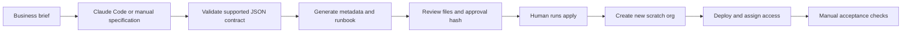

# Salesforce Demo Builder

**Turn a reviewed business brief into a repeatable Salesforce scratch-org demo.**

This project pairs a coding agent's requirements work with a deterministic Python compiler. Claude Code can help draft a specification; the compiler validates it, generates a Salesforce DX project and produces an approval hash. Deployment is a separate, explicit command that creates a new scratch org.

**Status:** functional local prototype. Generation and execution-control tests pass. A live Salesforce deployment has **not** been verified. This is not a production deployment framework or an unrestricted Salesforce implementation agent.

## Business problem

Early sales demonstrations often repeat the same setup work: agree on a use case, create custom objects and fields, configure access, and prepare a walkthrough. Keeping those decisions in a small specification makes the initial configuration reproducible and reviewable.

The first version deliberately supports a narrow slice of that work. It creates custom objects, fields, tabs, a Lightning app, page layouts assigned to the scratch-org administrator, a permission set, scratch-org configuration, and a demo runbook. It does not generate Flows, Apex, relationships, Lightning record pages, reports, or seed records. Unsupported requirements are rejected or documented as follow-up work rather than represented as completed.

## Architecture



The agent proposes. The compiler constrains. The human authorizes execution. Commands are assembled by Python and passed to Salesforce CLI as argument arrays; the model cannot supply arbitrary executable commands through the specification.

## Quick start: no Salesforce access required

Python 3.9+; no pip dependencies.

```bash
python3 demo_builder.py build examples/service-demo.json --out build/service-demo
python3 demo_builder.py plan build/service-demo
python3 -m unittest discover -s tests -v
```

The build command returns:

```json
{
  "status": "built_locally",
  "approval_hash": "<SHA-256 of the generated file manifest>"
}
```

Inspect `build/service-demo/force-app`, `demo-spec.json`, and `DEMO-RUNBOOK.md` before proceeding. `plan` checks file hashes, rejects additional files, and independently recompiles the specification to verify that only supported metadata is present. It does not check whether Salesforce will accept that metadata.

## Use with Claude Code

1. Start Claude Code inside this repository.
2. Ask it to follow `CLAUDE.md` and help turn your own business requirements into `private/demo-spec.json`.
3. Review its assumptions and unsupported requirements.
4. Let it run `build`, inspect the generated XML, and run tests.
5. Review the resulting files yourself before authorizing deployment.

Example request:

> Follow CLAUDE.md. Help me design a demo for tracking service requests. Ask about the fields and stages we need, write a supported specification in private/, and compile it locally. Explain unsupported requirements. Stop before any Salesforce login, scratch-org creation, or deployment.

Claude Code is optional and separately installed/authenticated. The Python compiler does not call an LLM API. Its deterministic behavior is usable without an AI subscription. This workflow is agent-assisted; it is not a deployed autonomous AI agent.

## Configure your own demo

Copy `examples/service-demo.json` to `private/demo-spec.json` and edit it. `private/` and `build/` are ignored by Git.

- Top-level fields: `name`, `business_problem`, `api_version`, `objects`, `demo_steps`.
- Custom object: `api_name`, `label`, `plural_label`, `fields`.
- Field: `api_name`, `label`, `type`; Text can specify `length`, Picklist must specify `values`.
- Supported types: Text, Email, Phone, Url, Number, Currency, Date, Checkbox, Picklist.
- Limits: 10 objects; 30 custom fields per object; API names ending in `__c`.
- Numeric fields use precision 18, scale 2. Other precision/scale requirements are outside this version.
- API version defaults to 66.0; choose a version supported by your Dev Hub.

The example contains no customer records. It exists for repeatable tests; the compiler accepts your own authorized requirements and never forces fictitious business data into an org.

## Create a real scratch org

Prerequisites: Salesforce CLI, an authorized Dev Hub you are permitted to use, and available scratch-org allocation. The tool has no environment variables or API keys of its own. Authentication stays in Salesforce CLI's credential store.

Log in yourself if needed:

```bash
sf org login web --alias personal-devhub --set-default-dev-hub
```

Then supply the exact hash returned by `plan`:

```bash
python3 demo_builder.py apply build/service-demo \
  --approve REPLACE_WITH_REVIEWED_HASH \
  --dev-hub personal-devhub \
  --alias service-demo-review \
  --days 1
sf org open --target-org service-demo-review
```

`apply` refuses an existing alias, creates a **new** scratch org, deploys only to the username returned by that creation, and assigns `DemoBuilderAccess`. It does not set a default target or accept an existing production/sandbox target. Review `DEMO-RUNBOOK.md` in the generated project and record observed results.

Live provisioning consumes your Dev Hub's scratch-org allocation. No live provisioning was performed when this project was prepared.

## Failure and cleanup

Each execution writes a private `.execution.json` receipt with the current step and completed steps. It does not retain raw Salesforce CLI output because that output can include credentials. An interrupted run can leave an org or an in-progress Salesforce job; inspect your Dev Hub and CLI job status before creating another build.

The tool blocks a second execution of the same build, including after a failure. There is no automatic resume, rollback, or deletion. Use Salesforce CLI directly for recovery after reviewing the actual state. Delete the temporary org yourself when finished:

```bash
sf org delete scratch --target-org service-demo-review
```

## Validation and limitations

Eleven offline tests cover XML escaping, specification rejection, path traversal, label-controlled paths, tampering, injected components, approval mismatch, existing aliases, explicit org targeting, and failure receipts. Salesforce calls in execution tests are mocked; passing those tests is **not** a live integration result.

Before presenting a real demo, verify creation/deployment on a personally authorized Dev Hub, object and field behavior, app visibility, permissions, and the actual walkthrough. No uptime, time-saving, client, or production claims are made.

## Contribution and AI assistance

Created with Codex from Itziar Fernández Fernández's brief about her Salesforce consulting workflow. Itziar defined the business direction; Codex generated the initial implementation, documentation, and automated tests. Itziar's hands-on review, live validation, and subsequent changes should be recorded as they happen. No employer repositories or client implementation files were used as source material.

## Security and ownership

Keep client briefs, credentials, org identifiers, generated projects, and execution receipts private. Review any file before sharing it with a coding agent or publishing it. Use an employer's Dev Hub only when authorized. A checksum is a review mechanism, not protection against someone deliberately bypassing the application; this is not a secure execution sandbox.

## References

- [Salesforce: create scratch orgs](https://developer.salesforce.com/docs/platform/sfdx-dev/guide/sfdx-dev-scratch-orgs-create.html)
- [Salesforce CLI scratch-org command](https://developer.salesforce.com/docs/platform/salesforce-cli-reference/guide/cli_reference_org_create_scratch.html)
- [Salesforce: create and test a scratch org](https://trailhead.salesforce.com/content/learn/projects/quick-start-salesforce-dx/create-and-test-our-scratch-org)
